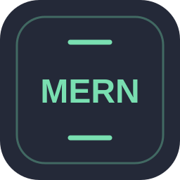
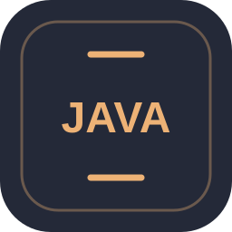
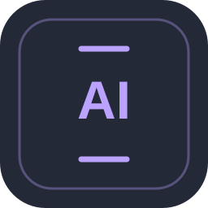
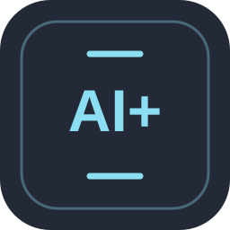
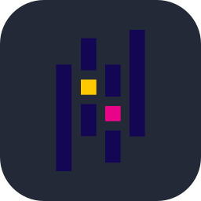
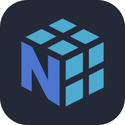
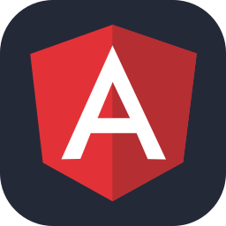
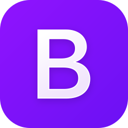
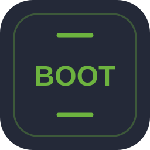
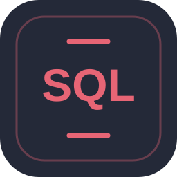

  

  <a href="https://www.starxinnovations.in/"><b>STARX ↗</b></a> &nbsp;&nbsp; · &nbsp;&nbsp;
  <a href="https://www.linkedin.com/in/mayurtank07/"><b>LINKEDIN ↗</b></a> &nbsp;&nbsp; · &nbsp;&nbsp;
  <a href="https://instagram.com/_i_am_mayur_tank_"><b>INSTAGRAM ↗</b></a>

 

### The person behind the code

**I'm Mayur Tank — Founder & CEO of StarX Innovations and IT Solutions, software developer, and technical educator based in Mumbai.**

My work sits at the intersection of **technology, business, and education**. I translate ideas into software and web experiences, bring a business perspective to development, and help learners connect programming concepts with practical implementation.

Through **StarX**, I bring together software development and digital marketing with a clear focus: creating a purposeful digital presence. As an educator, I make technical concepts approachable through hands-on examples and project-based learning.

**My approach: understand the problem, build with intent, and communicate with clarity.**

 

 

## 🧠 Tech Stack

<h3 align="center">Full Stack Development</h3>

   &nbsp;
  

MERN Stack &nbsp; · &nbsp; Java Full Stack

MERN: MongoDB · Express.js · React · Node.js Java Full Stack: Java · Spring · Spring Boot · frontend &amp; database development

 

<h3 align="center">AI & Data</h3>

   &nbsp;
   &nbsp;
   &nbsp;
   &nbsp;
  

Generative AI &nbsp; · &nbsp; Gen AI Products &nbsp; · &nbsp; Python &nbsp; · &nbsp; pandas &nbsp; · &nbsp; NumPy

 

<h3 align="center">Frontend & Web Interfaces</h3>

   &nbsp;
   &nbsp;
   &nbsp;
   &nbsp;
  

React &nbsp; · &nbsp; Angular &nbsp; · &nbsp; HTML &nbsp; · &nbsp; CSS &nbsp; · &nbsp; Bootstrap

 

<h3 align="center">Backend & Frameworks</h3>

   &nbsp;
   &nbsp;
   &nbsp;
   &nbsp;
   &nbsp;
  

.NET &nbsp; · &nbsp; Spring &nbsp; · &nbsp; Spring Boot &nbsp; · &nbsp; Django &nbsp; · &nbsp; Node.js &nbsp; · &nbsp; Express.js

 

<h3 align="center">Android Development</h3>

   &nbsp;
  

Android &nbsp; · &nbsp; Java

 

<h3 align="center">Databases & Persistence</h3>

   &nbsp;
   &nbsp;
   &nbsp;
   &nbsp;
  

MongoDB &nbsp; · &nbsp; MySQL &nbsp; · &nbsp; SQL Server &nbsp; · &nbsp; JDBC &nbsp; · &nbsp; Hibernate

 

<h3 align="center">Languages</h3>

   &nbsp;
   &nbsp;
   &nbsp;
   &nbsp;
   &nbsp;
   &nbsp;
  

Java &nbsp; · &nbsp; Python &nbsp; · &nbsp; JavaScript &nbsp; · &nbsp; C# &nbsp; · &nbsp; PHP &nbsp; · &nbsp; C++ &nbsp; · &nbsp; C

 

<b>Also in my toolkit</b> &nbsp; · &nbsp; Canva

---

  <b>Good ideas deserve thoughtful execution.</b>  
  For conversations around software, technical education, and digital business.  
  <a href="https://www.linkedin.com/in/mayurtank07/"><b>Let's connect ↗</b></a> &nbsp;&nbsp; · &nbsp;&nbsp;
  <a href="https://www.starxinnovations.in/"><b>Explore StarX ↗</b></a>

