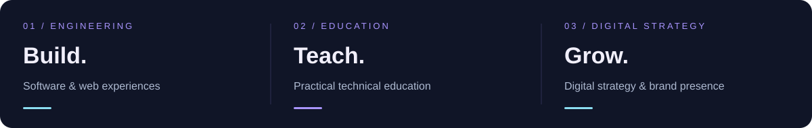

  

  <a href="https://www.starxinnovations.in/"><b>STARX ↗</b></a> &nbsp;&nbsp; · &nbsp;&nbsp;
  <a href="https://www.linkedin.com/in/mayurtank07/"><b>LINKEDIN ↗</b></a> &nbsp;&nbsp; · &nbsp;&nbsp;
  <a href="https://instagram.com/_i_am_mayur_tank_"><b>INSTAGRAM ↗</b></a>

 

### The person behind the code

**I'm Mayur Tank — Founder & CEO of StarX Innovations and IT Solutions, software developer, and technical educator based in Mumbai.**

My work sits at the intersection of **technology, business, and education**. I translate ideas into software and web experiences, bring a business perspective to development, and help learners connect programming concepts with practical implementation.

Through **StarX**, I bring together software development and digital marketing with a clear focus: creating a purposeful digital presence. As an educator, I make technical concepts approachable through hands-on examples and project-based learning.

**My approach: understand the problem, build with intent, and communicate with clarity.**

 

 

### Technology I work with

**WEB & INTERFACES** 
`JavaScript` &nbsp; `React` &nbsp; `Angular` &nbsp; `HTML` &nbsp; `CSS` &nbsp; `Bootstrap`

**APPLICATIONS & BACKEND** 
`Java` &nbsp; `Python` &nbsp; `PHP` &nbsp; `Django`

**DATABASES & PERSISTENCE** 
`MySQL` &nbsp; `SQL Server` &nbsp; `JDBC` &nbsp; `Hibernate`

More from my toolkit

 

`C` &nbsp; `C++` &nbsp; `C#` &nbsp; `Canva`

 

---

  <b>Good ideas deserve thoughtful execution.</b>  
  For conversations around software, technical education, and digital business.  
  <a href="https://www.linkedin.com/in/mayurtank07/"><b>Let's connect ↗</b></a> &nbsp;&nbsp; · &nbsp;&nbsp;
  <a href="https://www.starxinnovations.in/"><b>Explore StarX ↗</b></a>

